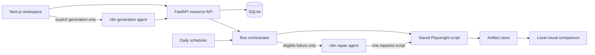
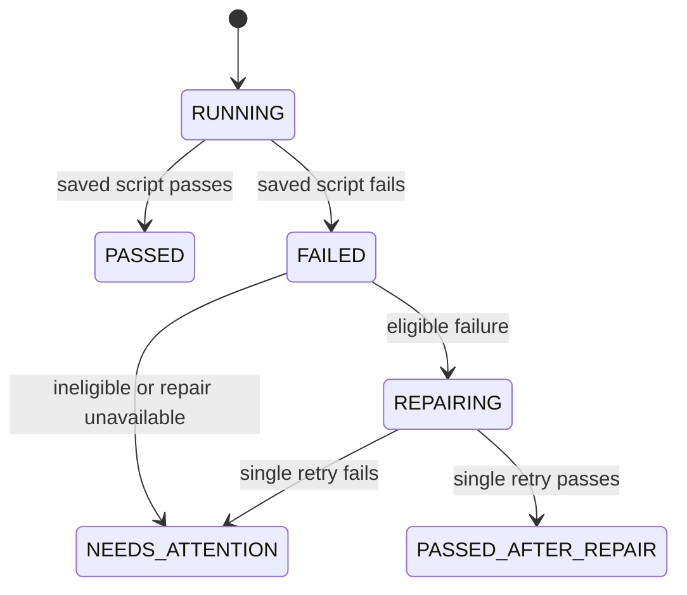

# Architecture

## Runtime boundaries

FastAPI owns resource state, orchestration, scheduling, retry policy, and artifact lifecycle. n8n never decides whether an operational run starts and does not sit in the normal execution path.

## Run lifecycle

The retry limit is one. Every trigger enters the same orchestrator and shares its per-scope overlap lock. SQLite stores projects, environments, journeys, schedules, runs, attempts, artifact metadata, and import markers. Every run captures an immutable script snapshot.

Artifact paths remain internal. Clients receive stable IDs, and the store validates that resolved paths remain under the configured root. Deletion moves evidence to recoverable trash before database cascade.

Generation accepts a target URL, objective, and credential metadata after explicit user confirmation. Repair accepts a compact redacted failure packet with bounded script, error, DOM, and selector excerpts. Malformed or timed-out responses fail closed to `NEEDS_ATTENTION`.

Model name, token budget, temperature, endpoints, and agent IDs are deployment configuration. Visual comparison runs locally; the visual n8n export is inactive and is not called at runtime.
