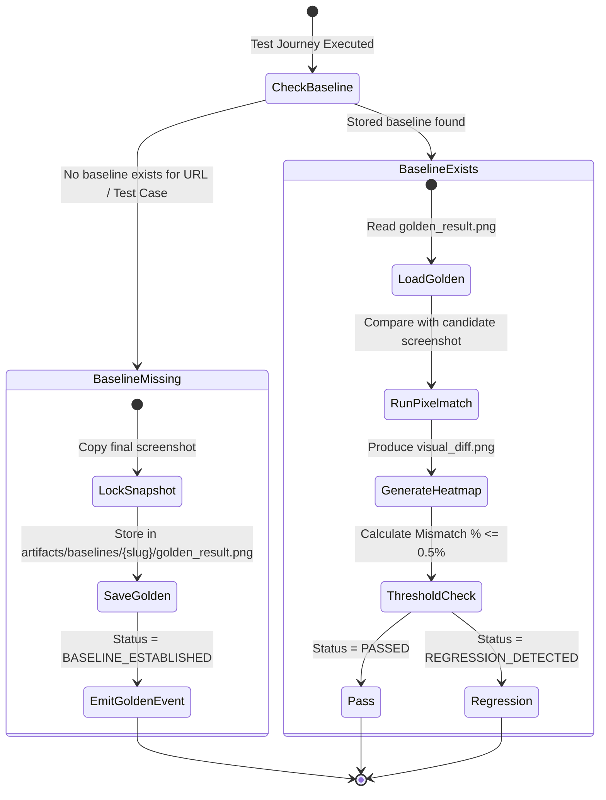

# Architecture Specification: AI Self-Healing Browser Automation System

## 1. Executive Summary
The **AI Self-Healing Browser Automation System** is an enterprise-grade autonomous testing platform that merges generative AI agent workflows (OpenAI GPT-4.1 via n8n Cloud MCP), deterministic browser execution (Python Playwright in Chromium), visual regression monitoring (Pixelmatch), and a responsive Next.js 14 control panel.

The platform eliminates the primary pain point of web automation: **test brittleness**. When web applications undergo markup changes, outdated IDs, or layout shifts, the system automatically diagnoses failures, synthesizes resilient code repairs, re-verifies tests in real-time, and flags visual regressions against established Golden Baselines.

---

## 2. System Architecture Diagram

```mermaid
flowchart TD
    subgraph UI ["Control Dashboard (Next.js 14 / Tailwind CSS)"]
        UI_Nav["Top Navigation & Preset Bar"]
        UI_Sidebar["Left Side Panel (Projects & Run History Tabs)"]
        UI_Agents["Agent Status Cards (Discovery, Exec, Diagnosis, Repair, Regression)"]
        UI_Config["Journey Config (URL, Masked Credentials, Headed Toggle)"]
        UI_Logs["Real-time Streaming Log Terminal"]
        UI_Editor["Playwright Script Viewer / Editor + Healed Diff"]
        UI_Diff["Visual Regression Heatmap & WebM Video Player"]
    end

    subgraph Backend ["FastAPI Orchestration Engine (Python 3.10+)"]
        API_Discovery["/api/discovery-and-generate"]
        API_ExecDirect["/api/execute-script (Direct Run + Auto-Heal)"]
        API_AutoRun["/api/autonomous-run (Full Pipeline)"]
        API_Repair["/api/diagnose-and-repair"]
        API_Suites["/api/test-cases (CRUD & Run)"]
        API_History["/api/runs (History Registry)"]
        API_Artifacts["/api/artifacts/{file_path:path}"]
        WS_Session["/ws/session (Telemetry & WebSocket Probes)"]
    end

    subgraph n8n_Layer ["n8n Cloud AI Agents (Workspace: zfT8YECLWRQZn3UH)"]
        Agent_Flow["Agent 1: Flow Discovery & Script Generator (QEzE1lGs9WbTU82H)"]
        Agent_Repair["Agent 2: Error Diagnosis & Adaptive Repair (p3Sh9BmTzLMC0f8A)"]
        Agent_Visual["Agent 3: Visual Regression Monitor (bS5GQjs2LrNHrJZH)"]
        OpenAI_GPT["OpenAI GPT-4.1 Reasoning Engine"]
        Agent_Flow --> OpenAI_GPT
        Agent_Repair --> OpenAI_GPT
        Agent_Visual --> OpenAI_GPT
    end

    subgraph Runner ["Playwright Chromium Engine & Security Layer"]
        PW_Browser["Chromium Browser (Headed / Headless with Slow-Mo)"]
        PW_Redactor["Secret Redactor (Masks Plaintext Secrets in Real-Time)"]
        PW_Video["Video Recorder (1280x800 Session Recording)"]
        PW_Screenshots["Milestone Screenshot Capture"]
        PW_DOM["DOM & Accessibility Snapshot Generator"]
    end

    subgraph Storage ["Storage & Artifact Registry"]
        Store_Cases[("test_suites/cases.json")]
        Store_Runs[("test_suites/runs_history.json")]
        Store_Baselines[("artifacts/baselines/{slug}/golden_result.png")]
        Store_RunArtifacts[("artifacts/{run_id}/*.png, session_video.webm")]
    end

    UI_Config --> API_AutoRun
    UI_Editor --> API_ExecDirect
    UI_Sidebar --> API_Suites
    UI_Sidebar --> API_History

    API_Discovery <--> Agent_Flow
    API_Repair <--> Agent_Repair
    API_AutoRun --> Runner
    API_ExecDirect --> Runner

    Runner --> PW_Redactor --> UI_Logs
    Runner --> PW_Video --> Store_RunArtifacts
    Runner --> PW_Screenshots --> Store_RunArtifacts
    Runner --> PW_DOM --> Store_RunArtifacts

    Store_RunArtifacts --> API_Artifacts --> UI_Diff
    Store_Cases --> API_Suites --> UI_Sidebar
    Store_Runs --> API_History --> UI_Sidebar
    Store_Baselines --> API_Artifacts
```

---

## 3. Core Agent Specifications

### Agent 1: Flow Discovery & Script Generator
* **ID / Endpoint**: `QEzE1lGs9WbTU82H` (n8n Cloud Workflow)
* **Model**: OpenAI GPT-4.1
* **Role**: Analyzes target URL domain, form metadata, and journey objective. Synthesizes an async or sync Python Playwright test script.
* **Resilience Guidelines**:
  - Injects secrets exclusively through environment variables (`os.environ.get("AUTH_PASSWORD")`).
  - Employs multi-attribute selectors (e.g. `input[type='email'], input[name='username']`).
  - Uses role-based locators (`page.get_by_role("button", name="...")`) with `.first` fallbacks.
  - Takes milestone screenshots at key journey transition steps (`step_1_landing.png`, `step_2_credentials_filled.png`, `step_3_result.png`).

### Agent 2: Error Diagnosis & Adaptive Repair
* **ID / Endpoint**: `p3Sh9BmTzLMC0f8A` (n8n Cloud Workflow)
* **Model**: OpenAI GPT-4.1
* **Role**: Triggered automatically when an execution run exits with code `!= 0` or times out.
* **Inputs Ingested**:
  1. Full Python traceback / stderr log.
  2. Failure DOM snapshot (`dom_snapshot.html`).
  3. Last captured screenshot before failure.
* **Diagnostic Classifications**:
  - `BROKEN_SELECTOR`: Element ID or CSS class renamed or relocated in updated DOM.
  - `TIMEOUT_OR_TIMING`: Asynchronous API request did not populate UI within default timeout.
  - `MISSING_AUTHENTICATION`: Form submission was blocked by CSRF, validation rules, or incorrect credentials.
* **Healing Output**: Synthesizes a drop-in repaired Playwright script with resilient locator strategies and timing assertions.

### Agent 3: Visual Regression Monitor
* **ID / Endpoint**: `bS5GQjs2LrNHrJZH` (n8n Cloud Workflow) + Local Pixelmatch Engine
* **Algorithm**: **Pixelmatch** (anti-aliasing-aware pixel-by-pixel diff engine) + Pillow RGBA canvas normalization.
* **Output**:
  - Total pixels, mismatched pixel count, and mismatch percentage.
  - Magenta visual difference heatmap (`visual_diff.png`).
  - Pass/Fail decision against configurable tolerance threshold (default `0.5%`).

---

## 4. Smart Golden Baseline Lifecycle

To avoid false regression alerts during test creation, the system enforces a strict 2-stage lifecycle:

1. **First Execution**: Establishes the reference baseline. The UI displays `🌟 GOLDEN BASELINE ESTABLISHED` without flagging regression errors.
2. **Subsequent Executions**: Loads the locked golden snapshot and computes pixel deviations. If the deviation exceeds the tolerance threshold (default: 0.5%), the test is marked as `REGRESSION DETECTED` with magenta highlights.

---

## 5. Security & Credential Shield

The platform implements multi-layer secret protection across the stack:

| Layer | Implementation | Behavior |
| :--- | :--- | :--- |
| **UI Form** | Masked inputs | Passwords masked as `••••••••` with toggle button |
| **Generated Code** | Parameterized injection | Plain passwords never hardcoded; binds `os.environ.get("AUTH_PASSWORD")` |
| **Execution Subprocess** | Secure environment dict | Secrets injected directly into subprocess `os.environ` |
| **Streaming Logs** | Real-time regex redactor | Stdout and stderr filtered; matching secrets replaced with `[REDACTED_SECRET:••••••••]` |
| **Saved Test Suites** | Credential sanitization | Saved test cases store `password_masked: "••••••••"` rather than plaintext credentials |

---

## 6. Video Session Recording Architecture

* **Engine**: Playwright Chromium Context Video (`record_video_dir`).
* **Resolution**: 1280x800 standard viewport recording.
* **Flushing Mechanism**: The script wrapper guarantees `context.close()` is executed prior to `browser.close()`. This forces Chromium to flush all audio/video buffers to disk.
* **Serving**: Handled via `/api/artifacts/{file_path:path}` with `Content-Type: video/webm` and `Accept-Ranges: bytes` support for smooth HTML5 seeking and scrubbing.
