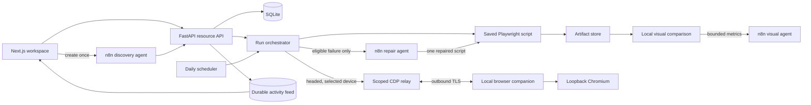
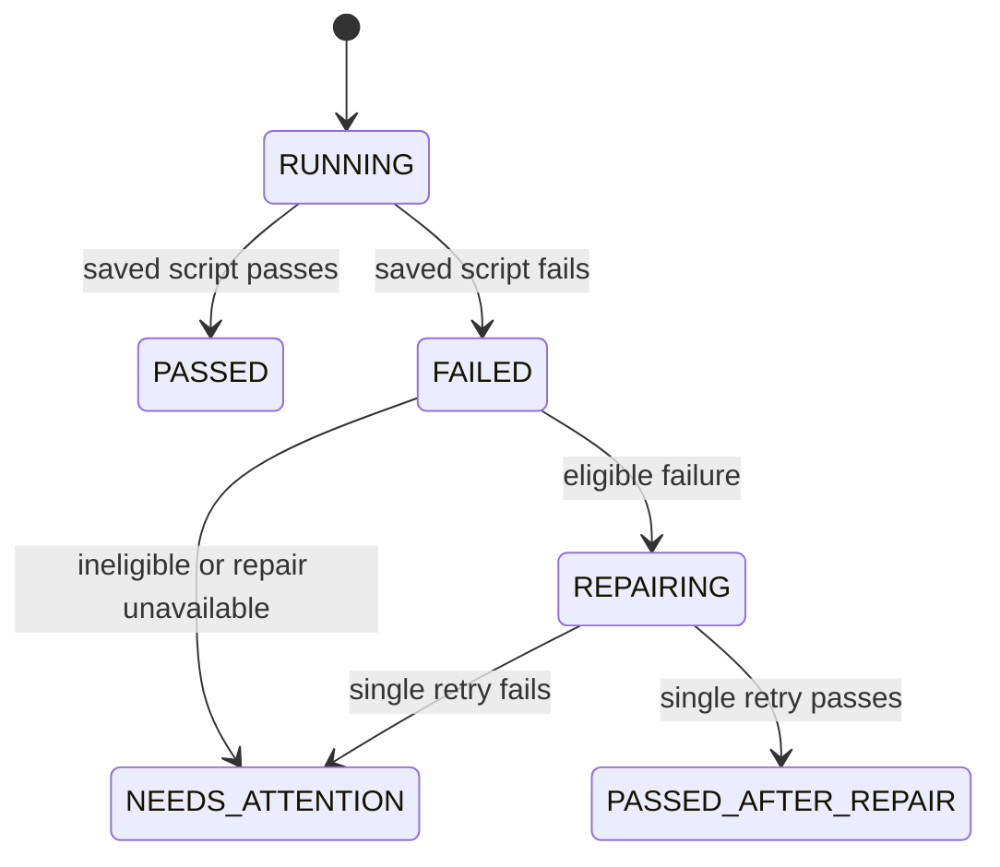

# Architecture

## Runtime boundaries

FastAPI owns resource state, orchestration, scheduling, retry policy, and artifact lifecycle. n8n never decides whether an operational run starts and does not sit in the normal execution path.

The execution adapter supports the isolated worker, a configured private Chrome DevTools endpoint, and a paired local companion for hosted headed runs. A companion session is scoped to one run and one device. The local companion uses a short-lived one-time pairing code, a revocable hashed device credential, an outbound WebSocket, and a loopback-only Chromium debugging socket. The runner receives a per-run relay URL and secret in its isolated environment; generated Python and reusable credentials never arrive as a separate companion job payload. CDP itself carries browser commands and may contain field values, so relay frames are never logged. Active relay sessions are in memory and require one backend process or sticky routing to that process.

## Run lifecycle

The retry limit is one. Every trigger enters the same orchestrator and shares its per-scope overlap lock. SQLite stores projects, environments, journeys, schedules, runs, attempts, artifact metadata, and import markers. Every run captures an immutable script snapshot.

Artifact paths remain internal. Clients receive stable IDs, and the store validates that resolved paths remain under the configured root. Deletion moves evidence to recoverable trash before database cascade.

Generation accepts a target URL, objective, and credential metadata after explicit user confirmation; the saved script automatically receives one first run. Repair accepts a compact redacted failure packet with bounded script, error, DOM, and selector excerpts. Malformed or timed-out responses fail closed to `NEEDS_ATTENTION`. Activity events are sequenced in SQLite and clients reconnect with `after_seq`; the runner reports only actions it actually observes.

Model name, token budget, temperature, endpoints, and agent IDs are deployment configuration. Visual comparison runs locally; when enabled and authenticated, the visual n8n agent receives only compact metrics. The exported n8n workflow JSON is reference material and is not the runtime invocation path.
