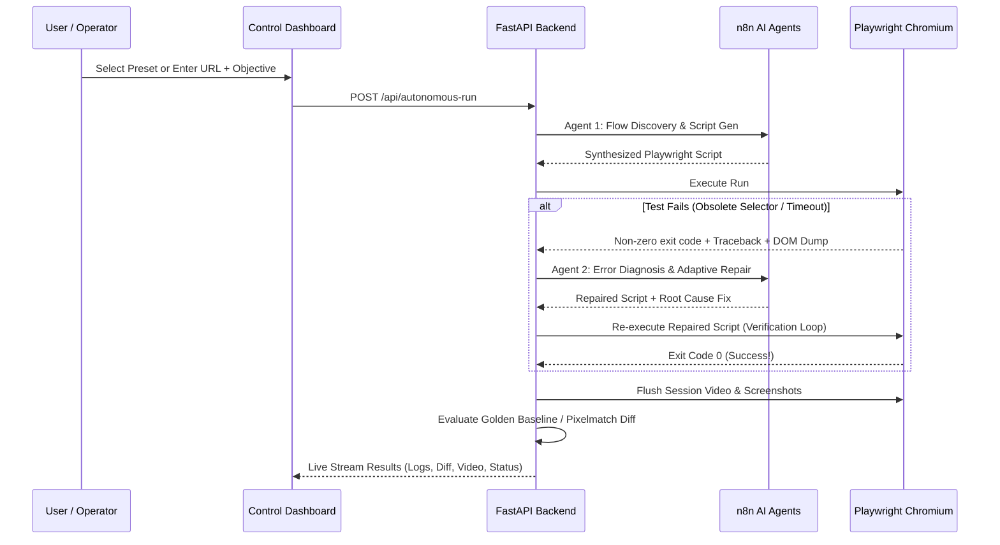

# AI Self-Healing Browser Automation System

[](https://nextjs.org/)
[](https://fastapi.tiangolo.com/)
[](https://playwright.dev/python/)
[](https://n8n.io)
[](https://github.com/mapbox/pixelmatch)

An autonomous browser automation and self-healing testing platform that discovers web flows, generates resilient Python Playwright scripts, executes tests in Chromium (headed or headless), diagnoses failures automatically, repairs broken selectors and timing races, records session videos, manages test suites in project folders, and monitors visual layout regressions against locked Golden Baselines.

---

## 🏛️ System Architecture


### Core Components
1. **Modern Control UI (Next.js 14+ / Tailwind CSS)**:
   - **Left Side Panel**: Integrated **Projects** and **Run History** tabs with search filtering, 1-click test execution, and run inspection.
   - **Playwright Script Viewer & Editor**: Live code diffing, interactive **"Edit Code"** mode, and direct **"▶ Run Script to Validate"** action.
   - **Visual Regression Monitor**: Pixelmatch visual difference heatmaps, Smart Golden Baseline lifecycle, and native Playwright WebM Session Video playback.
   - **Credential Shield**: Passwords masked in UI (`••••••••`), parameter bindings in code (`os.environ.get("AUTH_PASSWORD")`), and real-time regex redactor in logs (`[REDACTED_SECRET:••••••••]`).
2. **n8n AI Agents (OpenAI GPT-4.1 on n8n Cloud)**:
   - Hosted under Project Workspace `zfT8YECLWRQZn3UH`.
   - **Agent 1: Flow Discovery & Script Generator** (`QEzE1lGs9WbTU82H`).
   - **Agent 2: Error Diagnosis & Adaptive Repair** (`p3Sh9BmTzLMC0f8A`).
   - **Agent 3: Visual Regression Monitor** (`bS5GQjs2LrNHrJZH`).
3. **Deterministic Python Playwright Engine**:
   - Headed mode on macOS (`slow_mo=600ms`) and background headless mode.
   - Guaranteed `context.close()` video flushing for uncorrupted 1280x800 WebM session videos.
   - Subprocess log streaming and DOM snapshot capture.
4. **Smart Golden Baseline Lifecycle**:
   - Run 1 locks the milestone screenshot as reference Golden Baseline (`🌟 GOLDEN BASELINE ESTABLISHED`).
   - Run 2+ performs sub-pixel Pixelmatch diffing without generating false regression alerts.

---

## 📚 Documentation Index

| Document | Purpose |
| :--- | :--- |
| **[ARCHITECTURE.md](ARCHITECTURE.md)** | Full System Architecture, Mermaid flows, multi-agent contracts, and state machines |
| **[API_REFERENCE.md](API_REFERENCE.md)** | Complete REST & WebSocket API documentation with curl examples and payload schemas |
| **[USER_GUIDE.md](USER_GUIDE.md)** | End-to-end operator guide: presets, headed mode, editing code, test suites, and video |
| **[N8N_AGENTS.md](N8N_AGENTS.md)** | n8n Cloud workflows, prompt contracts, and MCP integration details |

---

## 🚀 Quick Start

### 1. Prerequisites
- Python 3.10+
- Node.js 18+ and npm

### 2. Backend Setup
```bash
cd backend

# Create virtual environment (first time only)
python3 -m venv .venv
source .venv/bin/activate
pip install -r requirements.txt
playwright install chromium

# Start the FastAPI engine (auto-redirects to .venv)
python3 server.py
# Engine runs on http://127.0.0.1:8000
```

### 3. Frontend Setup
```bash
cd frontend

# Install dependencies (already bootstrapped)
npm install

# Start the Next.js control dashboard
npm run dev
# Dashboard opens on http://localhost:3000
```

---

## 🔒 Security & Credential Shield

- **In the UI**: Sensitive fields are masked by default (`••••••••`).
- **In Generated Code**: Passwords are never hardcoded. Plaintext passwords are substituted with environment bindings:
  ```python
  password = os.environ.get("AUTH_PASSWORD", "••••••••")
  ```
- **In Real-Time Logs**: The engine filters stdout/stderr. Any text matching credentials or token patterns is intercepted and replaced with `[REDACTED_SECRET:••••••••]`.
- **In Saved Test Cases**: Stored in `test_suites/cases.json` with masked credential metadata.

---

## 🔁 Self-Healing Workflow



---

## ☁️ Vercel Deployment

1. The `frontend/` directory is 100% Vercel-ready with zero hydration mismatch errors.
2. To deploy:
   ```bash
   cd frontend
   npx vercel
   ```
3. Set environment variable:
   - `NEXT_PUBLIC_BACKEND_URL`: URL of your deployed Python runner.
